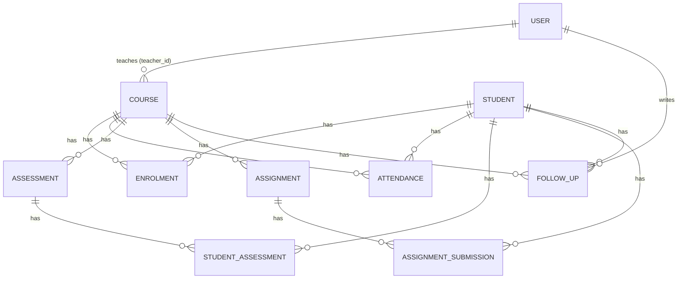

# Milestone 1 Foundation Guide (read this before starting your module)

## 1. The database in one picture

**Idea:** `Student` and `Course` are the two centres. `Enrolment` says which student is in
which course. Everything else (attendance, marks, submissions, follow-ups) hangs off a
student **and** a course, which is why risk is calculated per student-course pair.

## 2. The 10 tables

| Table (model) | Purpose | Key rules |
|---|---|---|
| `users` (User) | Admins and teachers, one table | unique email, `role` is admin/teacher, hashed password, `is_active` switch |
| `students` (Student) | Student details | own `id` primary key; `student_id` (college ID) and email are unique |
| `courses` (Course) | A course taught by one teacher | unique code; **`teacher_id` lives here** |
| `enrolments` (Enrolment) | Student <-> Course link | unique (student, course): no duplicate enrolment |
| `attendance` (Attendance) | One student, one course, one date | unique (student, course, date); status must be Present/Absent/Late/Excused |
| `assessments` (Assessment) | A test for a course | `max_marks` must be > 0 |
| `student_assessments` (StudentAssessment) | One student's marks | unique (assessment, student); `marks_obtained` NULL = **not graded** (not 0); never negative |
| `assignments` (Assignment) | An assignment with deadline | belongs to a course |
| `assignment_submissions` (AssignmentSubmission) | One student's status | unique (assignment, student); status is one of the 4 allowed values |
| `follow_ups` (FollowUp) | Teacher's action note | links student, course and teacher |

## 3. Relationships and delete behaviour

- Every relationship is two-sided (`back_populates`), e.g. `course.enrolments` and `enrolment.course`.
- **Delete a Student or Course** -> all of its child rows are deleted (cascade). Deleting a course never deletes students.
- **Delete a teacher** -> their courses stay, `teacher_id` becomes empty.
- **A teacher who wrote follow-ups cannot be deleted** (history protected). The app will *deactivate* teachers instead (`is_active = False`).
- SQLite normally ignores foreign keys. `models.py` switches them on for every connection, and a test proves it works.

**Rules the database cannot check, so the routes must:**
1. Attendance, marks, submissions and follow-ups only for a student **enrolled** in that course.
2. `marks_obtained <= max_marks`.
3. A follow-up's teacher must be that course's teacher.

## 4. Authentication flow

1. Browser opens `/` -> `auth.index` -> not logged in -> redirect to `/login`.
2. Login form (Flask-WTF) is submitted with a hidden **CSRF token**. If the token is missing or wrong the request is refused (400).
3. `auth.login` looks up the user by lower-cased email, checks `is_active` and the **password hash**. Failure shows one generic message ("Invalid email or password").
4. On success `login_user()` stores the user's id in a signed, HttpOnly session cookie, then redirects by role: admin -> `admin.dashboard`, teacher -> `teacher.dashboard`.
5. On every later request Flask-Login calls `load_user()` to fetch the user from the database. Deactivated users count as logged out.
6. **Role protection:** `admin.py` and `teacher.py` each have a `before_request` function that runs before *every* route in that file: not logged in -> login page; wrong role -> 403. You cannot forget to protect a new route, and hiding a button is never the only protection.
7. Logout is a **POST** with a CSRF token (`auth.logout`).

**Not automatic:** the *course ownership* check for teachers. In Milestone 2 every teacher route with a `course_id` must verify `course.teacher_id == current_user.id`.

## 5. Important files

| File | What to know |
|---|---|
| `app/__init__.py` | `create_app()`: connects database, login manager, CSRF, blueprints, error pages |
| `app/models.py` | All tables. **Shared by everyone: agree changes first** |
| `app/auth.py` | Login, logout, `load_user`, role-based redirect |
| `app/admin.py` / `app/teacher.py` | Role-protected pages; add your routes here |
| `app/reports.py` | Shared reports (login required); used in Milestone 3 |
| `app/forms.py` | All Flask-WTF forms |
| `app/templates/base.html` | Layout: top bar, role-based sidebar, flash messages, CDN links. Every page `extends` it |
| `config.py` | Secret key, database location, cookie settings, test config |
| `seed.py` | Demo accounts, safe to re-run |
| `tests/` | `test_auth.py` (login, roles, CSRF), `test_models.py` (database rules) |

## 6. Decisions made in Milestone 1 (tell us if you disagree)

- Added `users.is_active` so teachers are deactivated rather than deleted.
- Student `email` is unique (duplicate emails are almost always typing mistakes).
- Blueprints are single files (`admin.py`, not an `admin/` package) to keep things simple.
- Login ignores the `?next=` redirect parameter (always goes to your dashboard), avoiding open-redirect problems.
- The login form does not validate email format, so it never blocks the `.test` demo addresses.
- Passwords use `pbkdf2:sha256` hashing, which works on every Python build.
